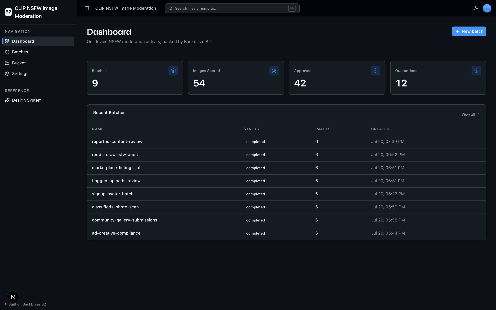
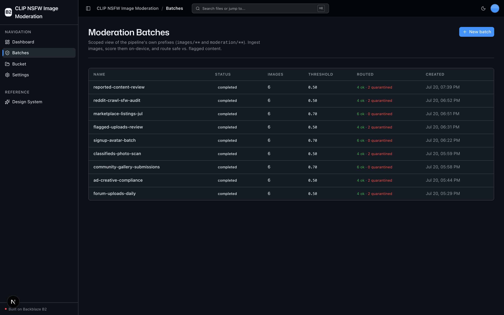
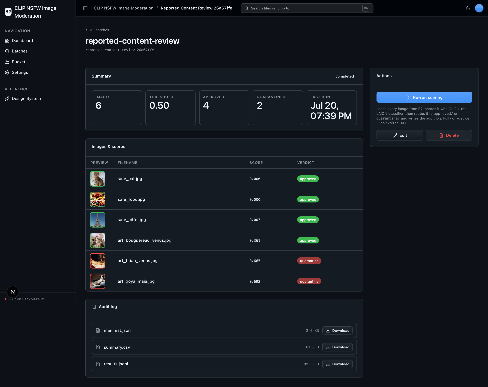
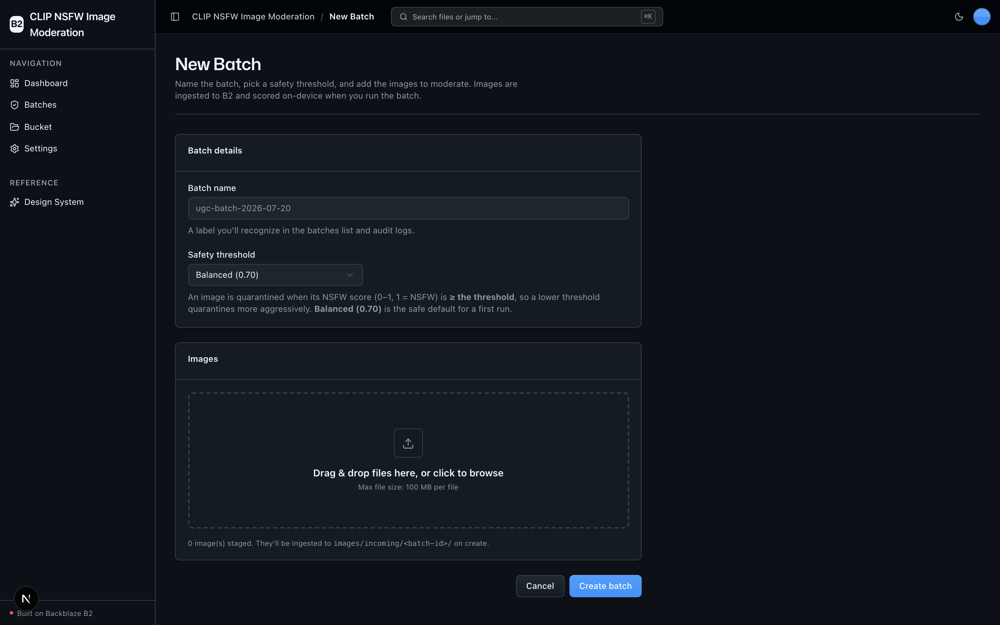

<!-- last_verified: 2026-07-20 -->
# CLIP NSFW Image Moderation

A self-hosted, **on-device** content-moderation pipeline for UGC platforms,
social networks, and dataset marketplaces that ingest large volumes of
user-submitted or crawled images. It scores every image 0–1 (1 = NSFW) using
**[LAION-AI's CLIP-based NSFW Detector](https://github.com/LAION-AI/CLIP-based-NSFW-Detector)**
— CLIP (ViT-L/14) image embeddings fed into LAION's trained AutoKeras safety
classifier — so image bytes **never leave your infrastructure** for a
third-party moderation API. **[Backblaze B2](https://www.backblaze.com/sign-up/ai-cloud-storage?utm_source=github&utm_medium=referral&utm_campaign=ai_artifacts&utm_content=b2ai-clip-nsfw-moderation)**
is the staging, routing, quarantine, and audit-log store for the whole flow.

No second API key — **B2 credentials only.**

## What it looks like

**Dashboard** — moderation totals (batches, images scored, approved, quarantined) above a recent-batches table.



**Moderation batches** — every batch with its status, safety threshold, and approved-vs-quarantined routing at a glance.



**Batch detail** — per-image NSFW scores and approved/quarantine verdicts, plus the audit log (manifest, summary CSV, results JSONL) written to B2.



**New batch** — name the batch, pick a safety-threshold preset, and drop in the images to moderate.



**What you get out of the box:**
- On-device NSFW scoring (CLIP ViT-L/14 + LAION AutoKeras classifier), CPU by
  default with CUDA → Apple MPS → CPU autodetect
- Moderation batches: ingest → score → automatic routing → audit logs on B2
- Full-stack dashboard UI (Next.js 16 + React 19 + Tailwind v4 + shadcn/ui)
- A scoped **Batches** explorer plus the raw full-bucket **Bucket** explorer
- FastAPI backend with strict layered architecture and structural tests

## How it works

```
images/incoming/<batch-id>/<filename>     # 1. ingest images + manifest
        │
        ▼  CLIP embedding → LAION classifier → score 0..1  (on-device)
        │
   score >= threshold ?
     yes ├─────────────► images/quarantine/<batch-id>/<filename>
      no └─────────────► images/approved/<batch-id>/<filename>
        │
        ▼
moderation/logs/<batch-id>/results.jsonl  # per-image {key, score, verdict}
moderation/logs/<batch-id>/summary.csv    # batch totals + threshold + run ts
```

An image is **quarantined** when its score is `>= threshold`, so a *lower*
threshold quarantines more aggressively. Three presets ship: **Strict (0.50)**,
**Balanced (0.70, default)**, and **Lenient (0.90)**.

## B2 as the storage layer

All access is the **S3-compatible API** via `boto3` (no b2-native SDK), with a
custom `user_agent_extra` of `b2ai-clip-nsfw-moderation` on the S3 client. B2 is
used for every stage: ingest (`put_object`), scoring reads (`get_object`),
routing (`copy_object` + `delete_object`), audit exports (`put_object`), and
listing (`list_objects_v2`). Quarantined images are retained under
`images/quarantine/` for human review.

## Quick Start

You need: Node.js >= 20, pnpm >= 9, Python >= 3.11, and a free
**[Backblaze B2 account](https://www.backblaze.com/sign-up/ai-cloud-storage?utm_source=github&utm_medium=referral&utm_campaign=ai_artifacts&utm_content=b2ai-clip-nsfw-moderation)**.

**1. Install dependencies**

```bash
pnpm install
```

**2. Set up the backend** (this installs PyTorch + TensorFlow, so it can take a
few minutes and a few GB of disk)

```bash
cd services/api
python3 -m venv .venv && source .venv/bin/activate
pip install -r requirements.txt
cd ../..
```

**3. Add your B2 credentials**

```bash
cp .env.example .env
```

Open `.env`, then head to the
[Backblaze B2 dashboard](https://secure.backblaze.com/b2_buckets.htm?utm_source=github&utm_medium=referral&utm_campaign=ai_artifacts&utm_content=b2ai-clip-nsfw-moderation) and:

1. **Create a bucket** and paste its **Unique Name** → `B2_BUCKET_NAME`. Read the
   bucket's **Endpoint** (e.g. `s3.us-west-004.backblazeb2.com`) and paste just
   the region segment → `B2_REGION` (e.g. `us-west-004`). The app derives the
   S3 endpoint as `https://s3.{B2_REGION}.backblazeb2.com`.
2. **Create an application key** with `Read and Write` permission:
   - **keyID** → `B2_APPLICATION_KEY_ID`
   - **applicationKey** → `B2_APPLICATION_KEY` *(only shown once — paste it now)*

> Walkthroughs: [creating a bucket](https://www.backblaze.com/docs/cloud-storage-create-and-manage-buckets?utm_source=github&utm_medium=referral&utm_campaign=ai_artifacts&utm_content=b2ai-clip-nsfw-moderation) and [creating app keys](https://www.backblaze.com/docs/cloud-storage-create-and-manage-app-keys?utm_source=github&utm_medium=referral&utm_campaign=ai_artifacts&utm_content=b2ai-clip-nsfw-moderation).

**4. Run it**

```bash
pnpm dev
```

Frontend at `localhost:3000`, API at `localhost:8000`. Go to **Batches → New
batch**, add a few images, pick a threshold, create, then **Run scoring**. The
first run downloads the CLIP weights and the LAION SavedModel (cached under
`services/api/models/`), so it takes longer than subsequent runs.

`pnpm dev` runs `pnpm doctor` first — a preflight check for the common setup
gotchas (wrong Node/Python version, missing venv, missing or placeholder
`.env`, ports already taken).

### On-device model & devices

- **CLIP stage** runs on the first available of **CUDA → Apple MPS → CPU** and
  defaults to CPU. A GPU is never required. Override with `MODERATION_DEVICE`.
- **The LAION AutoKeras classifier always runs on CPU** (TensorFlow has weak MPS
  support on macOS). The model is small, so this is fine.
- On macOS arm64, the TensorFlow 2.15 + AutoKeras load path can be fragile; the
  pinned versions in `requirements.txt` are the known-good line.

## Building on this project

- **Keep** the UI kit (`apps/web/src/components/ui/` + design tokens in
  `globals.css` + `/design`) and the full-bucket **Bucket** explorer (`/files`).
- **Adapt** the Dashboard (`/`) — it shows moderation stats and recent batches.
- **Rebrand** by editing `apps/web/src/lib/app-config.ts` (`APP_NAME`,
  `APP_DESCRIPTION`).

Full contract: [AGENTS.md §2](AGENTS.md#2-building-on-this-project).

## Core Features

- [Moderation Batches](docs/features/moderation-batches.md) — create/read/edit/delete/run the primary entity
- [NSFW Scoring](docs/features/nsfw-scoring.md) — on-device CLIP + LAION classifier
- [Routing & Quarantine](docs/features/routing-quarantine.md) — automatic approved/quarantine routing on B2
- [Audit Logs](docs/features/audit-logs.md) — per-image `results.jsonl` + batch `summary.csv`
- [Dashboard](docs/features/dashboard.md) — moderation stats and recent batches
- [File Browser](docs/features/file-browser.md) — the raw full-bucket explorer
- [Design System](docs/design-system.md) — tokens, primitives, error/empty states. Live preview at `/design`.

## Tech Stack

- TypeScript, Next.js 16, React 19, Tailwind v4, shadcn/ui
- TanStack Query — caching, dedup, retry for every fetch
- Python 3.11+, FastAPI, boto3, Pydantic v2, Pillow
- On-device ML: open_clip (CLIP ViT-L/14), PyTorch, TensorFlow 2.15 + AutoKeras (LAION NSFW classifier)
- Backblaze B2 (S3-compatible object storage)
- pnpm workspaces (monorepo)

## Commands

| Command | What it does |
|---------|-------------|
| `pnpm dev` | Start frontend + backend |
| `pnpm dev:web` | Frontend only |
| `pnpm dev:api` | Backend only |
| `pnpm build` | Build frontend |
| `pnpm lint` | Lint frontend |
| `pnpm lint:api` | Lint backend (ruff) |
| `pnpm test:web` | Run frontend unit tests (vitest) |
| `pnpm test:api` | Run backend tests |
| `pnpm check:structure` | Verify layering rules |
| `pnpm test:e2e` | Playwright e2e tests (run `pnpm --filter @clip-nsfw-image-moderation/web exec playwright install chromium` once first) |

## Documentation Map

| Doc | Purpose |
|-----|---------|
| [AGENTS.md](AGENTS.md) | Agent table of contents — start here |
| [ARCHITECTURE.md](ARCHITECTURE.md) | System layout, layering, data flows |
| [docs/features/](docs/features/) | Feature docs (batches, scoring, routing, audit, dashboard, file browser) |
| [docs/app-workflows.md](docs/app-workflows.md) | User journeys |
| [docs/dev-workflows.md](docs/dev-workflows.md) | Engineering workflows and testing |
| [docs/SECURITY.md](docs/SECURITY.md) | Security principles |
| [docs/RELIABILITY.md](docs/RELIABILITY.md) | Reliability expectations |
| [docs/exec-plans/](docs/exec-plans/) | Execution plans and tech debt tracker |

## License

MIT License - see [LICENSE](LICENSE) for details.

## Claude Agent B2 Skill

Manage Backblaze B2 from your terminal using natural language (list/search,
audits, stale or large file detection, security checks, safe cleanup).

Repo: [https://github.com/backblaze-b2-samples/claude-skill-b2-cloud-storage](https://github.com/backblaze-b2-samples/claude-skill-b2-cloud-storage)
